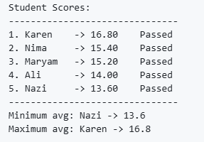

# Kotlin Learning

This repository contains my Kotlin learning journey.

I am learning Kotlin as the foundation for Android app development.

## Projects

### Project 01 — Student Grade Manager

A simple Kotlin program for managing student scores and analyzing their averages.

**Concepts practiced:**
- Maps
- Lists
- Functions
- Loops
- Conditions
- Collection operations
- Basic data processing

**Sample Output**

### Project 02 — Shopping Cart

A simple Kotlin shopping cart project.

**Concepts practiced so far:**
- Classes and Objects
- Properties and Methods
- Lists and Collections
- Loops
- Functions
- Calculating product and cart totals

**Status:** In progress