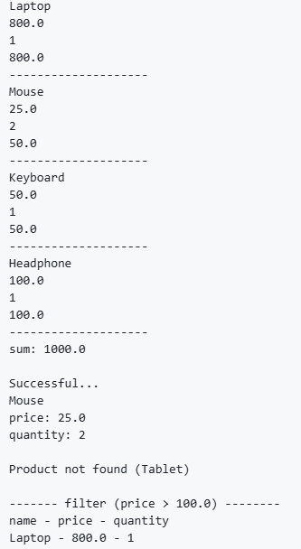

# Kotlin Learning

This repository contains my Kotlin learning journey.

I am learning Kotlin as the foundation for Android app development.

## Projects

### Project 01 — Student Grade Manager

A simple Kotlin program for managing student scores and analyzing their averages.

**Concepts practiced:**
- Maps
- Lists
- Functions
- Loops
- Conditions
- Collection operations
- Basic data processing

**Sample Output**

### Project 02 — Shopping Cart

A simple Kotlin shopping cart project that calculates totals, searches for
products, and filters items by price.

**Concepts practiced:**
- Classes and Objects
- Properties and Methods
- Lists and Collections
- Loops
- Functions
- Calculating product and cart totals
- Collection operations: `firstOrNull`, `filter`, `sumOf`
- Computed properties (`val total get() = ...`)
- Single responsibility: functions that only do one thing

**Versions:**

This project is kept in two versions so I can compare my first attempt
with a refactored version and see the improvements side by side.

- **v1 (Original)** — first attempt. Uses `flag` for searching, a `total()`
  function, and manual loops with accumulators.
- **v2 (Improved)** — refactored version. Uses a computed property,
  `firstOrNull`, `filter`, and `sumOf`. Also fixes a bug where the table
  header was printed inside the loop.

**What changed in v2:**
- `total()` → `val total get() = ...` (computed property)
- Replaced `flag`-based search with `firstOrNull { ... }`
- `findProduct` now returns `Product?` (single responsibility)
- Fixed a bug in `showExpensiveProducts`: header was printed inside the loop
- Added a "no products match" message when nothing passes the filter
- Replaced manual `for` + accumulator with `sumOf { ... }`
- Renamed `totalProducts` → `calculateTotalPrice`

**Known limitations:**
- Prices use `Double` for simplicity. In a real project, `BigDecimal`
  or integer cents would be more appropriate.

**Sample Output**

**Status:** Complete